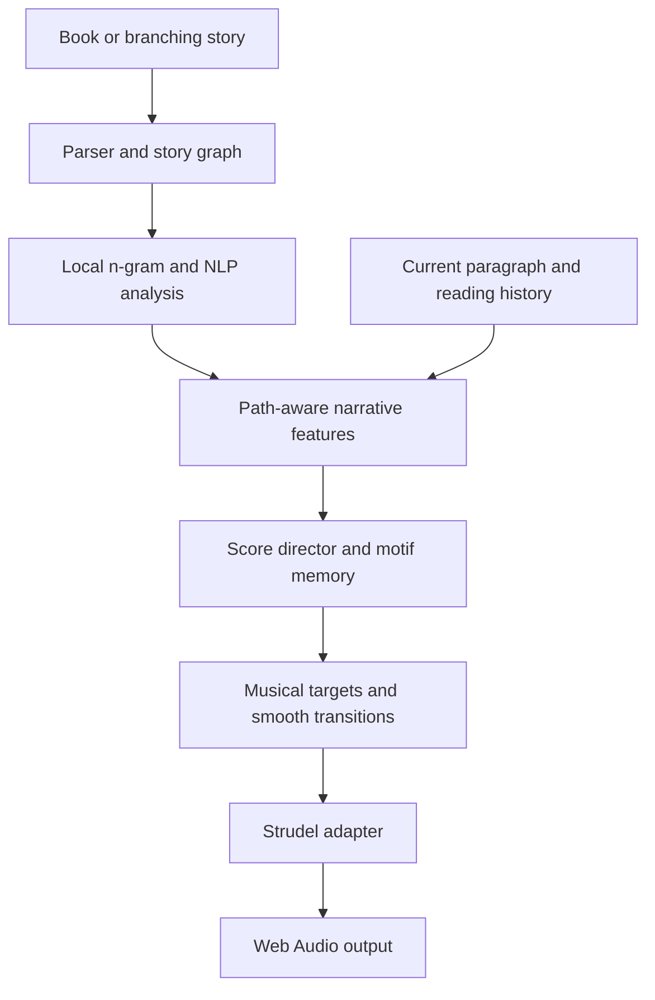

# Awen

*Every story has a soundtrack.*

**Awen** — Welsh for *poetic inspiration* — is an open-source e-reader project that pairs stories with adaptive, procedurally generated atmospheric soundtracks. Lightweight n-gram and NLP analysis will guide a continuous Strudel score as you read, with no LLM or generative AI.

The goal is a soundtrack that breathes with the story: a subtle pulse as tension rises, open textures for moments of wonder, and space for silence. The reader sets the pace.

> **Project status: specification and research.** This repository currently contains design documents, not a runnable application. The features below describe the planned implementation; no browser or E Ink compatibility has been demonstrated yet.

## The experience

- **Read at your own pace.** One paragraph at a time gives the soundtrack an explicit reading-position signal, with keyboard navigation and saved progress.
- **Hear a continuous score.** Drones, harmonic textures, sparse motifs and subtle pulses evolve together without restarting at paragraph boundaries.
- **Keep the story local.** Offline-first reading, analysis, synthesis and storage, with assets available locally after initial setup.
- **Follow different paths.** A story graph will support linear books and choose-your-own-adventure choices through the same reading and music pipeline.
- **Understand the adaptation.** Inspectable text features and a developer overlay will show why the music changes.
- **Work towards a dedicated reader.** Begin in the browser, then evaluate a standalone E Ink device that handles both reading and audio.

The first prototype will use the opening chapter of H. G. Wells's *The War of the Worlds*, with edition, source and distribution rights checked before bundling. The broader aim is to support suitably licensed books across genres.

## How it will work

The first analyser will use deterministic phrase dictionaries and linguistic cues to estimate valence, arousal, tension, mystery, wonder and action. A compact TF-IDF n-gram classifier is a later experiment, subject to evaluation on literary passages.

The score director will translate those features into bounded musical targets, maintaining a tonal identity and recurring motifs. Smoothing, hysteresis and musical timing will keep navigation from producing abrupt changes. Unvisited branches and future plot events must not leak into the audible score.

Procedural composition here means authored patterns, synthesis and explicit rules. It does not require a model to generate text, code or audio.

## Planned stack

| Area | Technology |
|---|---|
| Reader | TypeScript, React, Vite |
| Procedural score | Strudel behind an audio adapter |
| Mixing and playback | Web Audio API |
| Narrative analysis | Deterministic n-gram/NLP rules; optional local classifier later |
| Local data | IndexedDB; small settings may use localStorage |
| Preprocessing | Web Workers where needed |
| Offline availability | Local assets and an explicit application-cache strategy |
| Verification | Vitest, Playwright and listening evaluations |

The web app is intended to need no backend, account, API key or inference service. Dependency versions and package APIs will be confirmed during implementation.

## Roadmap

1. **Playable chapter:** paragraph reader, graph foundation, saved position and four-layer Strudel score with manual controls.
2. **Narrative automation:** auditable lexical features, smooth musical targets and a debug overlay.
3. **Continuity and choices:** motifs, branch navigation and history, accessibility, offline caching and audio lifecycle handling.
4. **Evaluation:** compare silence, fixed ambience and adaptive scoring; assess immersion, distraction, comprehension and narrative fit. Evaluate classifiers only after the baseline works.
5. **Standalone E Ink:** test the web application on an Android E Ink reader with supported audio. The discussion's provisional candidate was the Meebook M7, with BOOX Go 6 (Gen II) as an alternative; compatibility remains unverified.
6. **Further exploration:** EPUB and interactive-fiction imports, reader integrations and an optional embedded synthesis port.

ESP32/CrossPoint and legacy Kindle routes remain research options. A native renderer and verified audio hardware would be needed for constrained devices; the presence of Bluetooth alone does not establish headphone-audio support.

## Documentation

| File | Purpose |
|---|---|
| [Implementation specification](adaptive_reading_soundtrack_spec.md) | Requirements, data contracts, music rules, branching behaviour, research notes and E Ink roadmap |
| [Research paper draft](paper.md) | Background, related work, proposed architecture, research questions and evaluation methodology |

## Development

There are no application source files, package manifest or install/run scripts yet. Start with Milestone 1 in the specification; setup commands will be documented when the scaffold exists.

Contributions can begin with the reader/audio vertical slice, original synthesis presets, annotated literary passages, branching fixtures or reproducible hardware measurements. Keep domain logic independent of the UI and audio renderer, and keep analysis local and explainable.

## Acknowledgements and licensing

The concept draws on atmospheric film and radio scoring and the responsiveness of interactive game music. Strudel is the planned browser music engine. Related projects and scholarly sources are discussed in the paper; Awen does not claim to be the first adaptive reading soundtrack.

An open-source release is the project intent. No project licence has been selected or added yet. Before distributing an implementation, choose a licence compatible with the selected dependencies and retain the licences and attribution for code, book editions, lexicons, fonts, samples and other assets. No third-party media is bundled with these documents.
