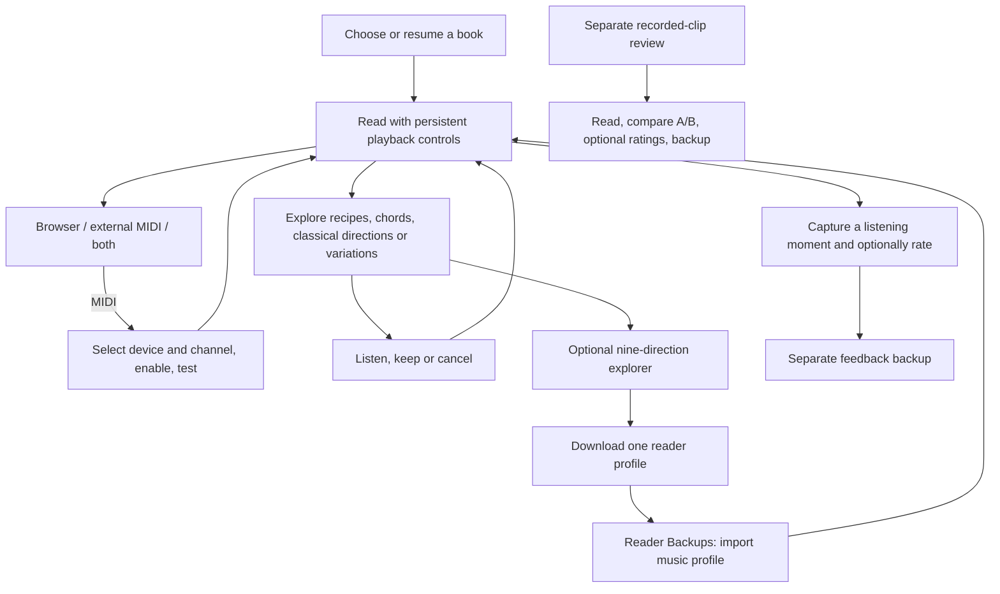

# User-flow review and implemented changes

8 November 2026, task `awen-ovo`. Baseline: commit `cbf32f1`.
The [feature inventory and user stories](user-stories.md) cover 44 stories across
reading, audio/MIDI, musical exploration, saving/feedback and research workflows.
The [engineering evidence](usability-proof.json) binds the final sources and checks.

## Method and limits

This is a source/feature inventory, heuristic review and automated task
walkthrough, with desktop/mobile screenshots. It is not a recruited-user study,
listening-quality judgement, comprehension experiment or formal accessibility
certification. The user's earlier FM1 confusion is a real reported friction
point; the screenshots/walkthroughs are engineering observations. All ratings
entered by tests are synthetic and stay outside real feedback/study data.

Reviewed surfaces: the single-file reader and its gallery, the nine-direction
explorer template/generator, calibration and recurrence review templates, and
the developer-facing CLAP grid/evaluator/multi-objective report surfaces. The
latter remain research reports; they were inventoried, not redesigned into the
ordinary reading journey. Frozen generated experiments were left intact.

## Findings and disposition

| Priority | Observation before changes | Implemented response |
|---|---|---|
| High | Mobile playback was below the passage; focus mode hid the entire sound sidebar. | Continue reading moves to a sticky transport with Start/Pause, Mute, paired previous/next and position. It remains present in focus mode; Sound settings reveals the sidebar. |
| High | Browser sound, MIDI performance and USB audio could be confused. The user had already experienced this. | Explicit Browser / External MIDI only / Both selector, actual route status and setup gate. Selecting hardware cannot start browser music while MIDI is unarmed. |
| High | Browser Check sound could be mistaken for a hardware MIDI test. Palette controls suggested they would change FM1 timbre. | Test browser sound is named separately from Test MIDI note. In external-only mode, palette is labelled as browser-preview colour; level is labelled MIDI velocity. |
| High | The nine-card action “Keep this direction” only selected a parent, which could be mistaken for adoption. | Select for next round and explicit selected count; profile download is a separate action with a documented reader handoff. |
| High | An explorer profile lost its palette on import, so its sound could unexpectedly change. | Explorer exports optional `readerSettings.palette`; reader validates it before any mutation and applies it along with the profile. Older profiles keep their previous semantics. |
| Medium | Profile save/import was buried in the variation panel; several JSON types had different meanings. | A Backups task entry/hub distinguishes music profile, listening feedback and story interpretation, with import/download shortcuts and surfaced completion/error messages. |
| Medium | Personal interpretation was under a technical inspector rather than discoverable while shaping music. | Explore music includes Interpret the scene, which reveals/focuses the existing interpretation controls. Debug/evidence remain available. |
| Medium | Returning from a long six-card gallery required reaching the bottom. | A sticky gallery header includes Return to reading and Mute. The explanation says previews use browser sound and returning pauses reading music. |
| Medium | Exploration actions and selection count were far from cards while scrolling; seed/settings competed with the main task. | Sticky selection/evolve/stop/previous actions; seed and excerpt length grouped under Advanced. Existing rounds/state are retained. |
| Medium | Long passages put recorded-clip review playback below the text; readers had to scroll back and forth. | Review templates have sticky A/B/Stop/backup controls and Read/Give feedback jump links. A short four-step introduction explains the review purpose. |
| Medium | The pages did not explain how exploration, reading and recorded-clip judgement related. | Page-specific task instructions and profile-versus-full-exploration backup distinctions. Optional packaged reader/explorer links support a round trip without introducing a core runtime dependency. |
| Low | A new route status could repeatedly announce unchanged text during playback. | Route text updates only when it changes. Native buttons, labels, keyboard focus and status outputs remain the interaction primitives. |

### Concrete layout observation

At 390 × 844 in the baseline, the main Start button began about **2,010 CSS px**
below the top of the initial document viewport; the passage began about 1,052 px
down. The new Continue reading action takes the user to the reading controls,
which are then sticky and usable in focus mode. The after-Continue measurement
is a different task state from the baseline initial viewport; it is not a claim
of a measured percentage improvement or a human task-time result. The proof
contains the actual geometry rather than treating these as matched timings.

## Intended journeys



### First read / return

Choose a shelf book or Continue reading. Start through the persistent control.
Set text appearance if needed; Focus removes the sidebar but keeps playback and
navigation. Sound settings is an escape route back to the full controls. The
clock, seed and running graph retain their existing behaviour while navigating.

### External synth

Choose External MIDI only or Both. The page pauses and reveals setup. Find the
device, select output/receive channel, enable and test MIDI, then Start. Actual
route status distinguishes generated browser audio from hardware performance.
Disabling MIDI explicitly returns to browser selection; a disconnect leaves
hardware requested so Start cannot silently substitute laptop audio. Browser
preview mode is stated explicitly. Physical levels/patches remain on the synth.

### Exploration and adoption

Explore music exposes existing broad/classical/chord/scene/DSL and variation
controls. The six-card gallery keeps explicit preview/keep/cancel semantics.
The optional nine-card page separates selecting parents from adopting a sound.
Its profile download carries one genome plus its browser palette; reader Backups
imports it. A whole exploration backup carries rounds and state, not a reader
profile. Hardware still uses the patch chosen on the synth.

### Feedback and recovery

Give feedback captures a listening context and leaves axes optional. Backups
offers a separate export/merge path. Music profiles, feedback and scene
interpretations remain distinct files. The hub explicitly says that progress
and MIDI setup stay on the device: this is not a newly implemented full-session
backup. Original profile/file freshness, failures, feedback conflicts and storage
protections retain their underlying handlers; the hub exposes their status.

### Recorded-clip review

Read → compare A/B → answer what you can → download a backup. Controls remain
reachable while reading long text or answering. Ties, unsure, unanswered, optional
notes/confidence and saved responses remain. These pages do not adopt music into
the reader and do not promise a correct answer. No candidate identity is exposed
by the new flow text.

## Packaging, preservation and reproduction

`index.html` remains runnable alone, with inline CSS/JS and no new dependency.
An optional explorer hint is a same-origin HTTP(S)/local-file link, exposed only
when explicitly configured. The maintenance generator can package both pages:

```powershell
python tools/exploration_page.py --include-reader
# Serve the printed folder on loopback, then open:
# index.html?explorer=explore.html
```

This copies the unchanged reader and generates `explore.html`; it is not a build
step required for the reader. `--reader-url` remains available for separately
hosted pages. The generator rejects active-content/protocol-relative reader links.
No page imports external scripts or requires a runtime model.

The composer/planner, synthesis, shared browser limiter and MIDI message engine
were not redesigned. Existing IDs, saved reader/profile/feedback structures and
ordinary seeds remain compatible. Profile import gains only optional, validated
palette metadata. Native reader profile backups retain their prior scope; a
full settings/progress backup remains separate backlog work.

Review changes apply to source templates and newly generated pages. Existing
frozen experiment directories, WAVs, private keys, packet identities and recorded
responses are not overwritten or silently resumed with changed sources. Review
QA uses new TEST ONLY packet identities and copies of previously rendered clips;
it creates no new music corpus or model-processing run. Previous source-bound
experiments still require their original sources for compatible replay.

## Verification

The proof links automated first-read/focus/MIDI-gate, explorer-profile/palette
handoff, bad-profile atomic rejection and feedback-backup journeys. Review
walkthroughs check sticky exclusive playback, optional ratings, backup download,
silent reload and no mobile overflow for both templates. Existing native audio,
evolution, MIDI, feedback, exploration and packet tests cover preserved behaviour.
Desktop/mobile dark screenshots are visually inspected. Check names/counts and
source hashes are recorded in the proof; sample checks do not establish sound
quality or physical FM1 loudness.

## Remaining usability work

Actual short sessions with first-time and returning readers are the next gate:
can they identify the active audio source, stop quickly, find a musical direction,
understand selected parents versus adoption, and restore the correct backup?
Measure task success, confusion, recovery and subjective burden separately.
Real mobile/browser/device acceptance, listening fatigue, full-session backups,
feedback-notebook rotation, archived comparison replay and an accessibility audit
remain in Beads. This review is an implemented flow pass, not evidence that all
users find the tool easy or that a soundtrack improves reading.
